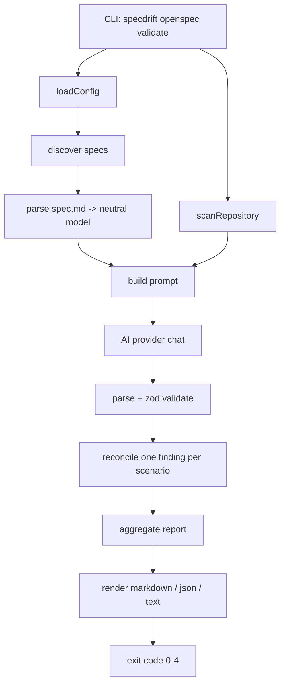
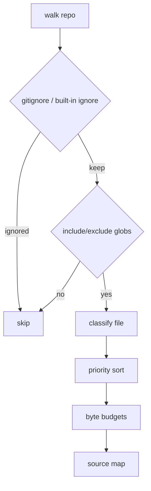

# specdrift — Architecture

> **Status:** living architecture reference (supersedes the original
> implementation plan).
> **Repository:** https://github.com/ahlp/specdrift
> **Package / command:** `specdrift` (historically `sdd`)
> **Reference fixture:** `ahlp/flood-status-recife`

`specdrift` is a **framework-agnostic semantic spec validator**. It compares
formal specs against real repository code using an AI provider and reports
where they drift, with evidence and a suggested fix. It is report-only: it never
modifies code or specs.

---

## 1. Approach

The decisions below shape every layer of the codebase.

### 1.1 Framework-agnostic core, pluggable spec adapters

The validation engine knows nothing about OpenSpec. It operates on a **neutral
spec model** (capability → requirement → scenario → steps). Each spec format is
a small adapter that discovers files and maps them into that model. OpenSpec is
the first adapter; Gherkin, Markdown/RFC, and ADR adapters are planned without
any changes to the core.

### 1.2 Report-only, never mutate

`specdrift` is an observation tool. It produces findings and suggestions, but
does not edit code or specs. This keeps it safe to run in CI and review loops.

### 1.3 Scenario-level granularity

Findings are produced **one per scenario**, which is how OpenSpec (and BDD-style
formats generally) express behavior. Requirements and specs roll up from
scenario statuses.

### 1.4 Explicit coverage

A model that silently omits a scenario is dangerous. The reconciler guarantees
one finding per scenario: anything the model does not report is marked
`inconclusive`, so coverage is always explicit.

### 1.5 Resilient, non-fatal parsing

Specs are prose, not code. The parser emits warnings for malformed structure
instead of hard-failing, so semantic validation can still run on imperfect
specs.

### 1.6 Local-first, privacy-aware

LM Studio and Ollama (local) are preferred. The cloud provider (DeepSeek) prints
a warning before any repository content leaves the machine.

### 1.7 Bounded, relevant context

Repository context is `.gitignore`-aware, byte-budgeted, and relevance-ranked per
spec, so prompts stay within a model's context window without arbitrary
truncation of the most relevant files.

### 1.8 Validated, deterministic output

The model is asked for a specific JSON shape, which is then parsed and validated
with `zod`. Aliases and casing are normalized, and malformed output degrades to
`inconclusive` rather than crashing the run.

### 1.9 Predictable configuration precedence

CLI flags > environment > config file > defaults. One code path resolves
everything, and unknown config keys are rejected.

---

## 2. Repository layout

```
specdrift/
├── .github/workflows/ci.yml   # GitHub Actions
├── src/
│   ├── cli/                   # entrypoint, command registration
│   │   ├── index.ts
│   │   └── commands/
│   │       ├── openspec.ts    # openspec command group (format adapter command)
│   │       └── validate.ts    # validate orchestration + exit codes
│   ├── config/                # .specdriftrc + SPECDRIFT_* resolution
│   │   ├── load.ts
│   │   └── schema.ts
│   ├── openspec/              # OpenSpec spec-format adapter
│   │   ├── discover.ts
│   │   ├── parse.ts
│   │   └── types.ts           # the neutral Spec model
│   ├── repo/                  # repository source-map scanner (format-agnostic)
│   │   ├── scan.ts
│   │   ├── read.ts
│   │   └── types.ts
│   ├── ai/                    # provider abstraction + prompt construction
│   │   ├── provider.ts
│   │   ├── http.ts
│   │   ├── lmstudio.ts
│   │   ├── ollama.ts
│   │   ├── deepseek.ts
│   │   ├── detect.ts
│   │   └── prompt.ts
│   ├── validate/              # response contract, reconciliation, aggregation
│   │   ├── result.ts
│   │   └── run.ts
│   ├── report/                # renderers
│   │   ├── markdown.ts
│   │   ├── json.ts
│   │   ├── text.ts
│   │   ├── labels.ts
│   │   └── index.ts
│   └── index.ts               # public library API
├── test/                      # unit + integration tests, manual runner
└── package.json               # bin: specdrift, prepack builds dist/
```

---

## 3. Pipeline



---

## 4. Neutral spec model and adapters

The core consumes the model defined in `src/openspec/types.ts`:

```ts
interface Spec {
  name: string;
  path: string;
  purpose: string;
  requirements: Requirement[];
  warnings: ParseWarning[];
  raw: string;
}

interface Requirement {
  title: string;
  statement: string;
  scenarios: Scenario[];
  raw: string;
}

interface Scenario {
  title: string;
  steps: ScenarioStep[]; // GIVEN / WHEN / THEN / AND / BUT
  raw: string;
}
```

### Adapter contract

To add a new spec format, an adapter must:

1. **discover** spec files for that format, and
2. **parse** them into the neutral `Spec` model.

It can then reuse `scanRepository`, `validateProject`, and the report renderers
unchanged. The CLI is structured per format: `specdrift <format> validate`.
Planned adapters: `gherkin`, `markdown`/RFC, `adr`.

### OpenSpec adapter (implemented)

- **Discovery** (`src/openspec/discover.ts`): finds `openspec/specs/**/*.md` and
  the optional `openspec/config.yaml`. Accepts either the `openspec/` directory
  or the `specs/` directory.
- **Parsing** (`src/openspec/parse.ts`): keys off structural markers
  (`## Purpose`, `### Requirement:`, `#### Scenario:`) and bold
  `**GIVEN/WHEN/THEN**` labels. Language-agnostic (English, Portuguese, mixed).
- **Config** (`parseConfig`): surfaces `schema`, `context`, `rules`,
  `operations` — `context`/`rules` are injected into the prompt.

---

## 5. Repository scanning (`src/repo`)

`scanRepository` produces a compact, token-bounded source map:

- Walks the repository honoring `.gitignore` plus a built-in ignore list
  (VCS, build output, lockfiles, `.env`, binaries, and `openspec/` itself).
- Supports `--include` allowlists and `--exclude` globs (`minimatch`).
- Classifies files: `source`, `config`, `test`, `docs`, `other`.
- Prioritizes source files before applying per-file and total byte budgets.
- Caps each file and marks truncation; skips binary content.



---

## 6. AI providers (`src/ai`)

All providers implement one interface:

```ts
interface Provider {
  readonly id: "lmstudio" | "ollama" | "deepseek";
  readonly isLocal: boolean;
  chat(messages: ChatMessage[], options?: ChatOptions): Promise<string>;
  healthCheck(timeoutMs?: number): Promise<boolean>;
}
```

| Provider  | Endpoint                      | Key      | Notes                                                   |
| --------- | ----------------------------- | -------- | ------------------------------------------------------- |
| LM Studio | `http://localhost:1234/v1`    | none     | OpenAI-compatible                                       |
| Ollama    | `http://localhost:11434`      | none     | native `/api/chat`; `/v1` switches to OpenAI-compatible |
| DeepSeek  | `https://api.deepseek.com/v1` | required | cloud, `deepseek-chat` default                          |

- **Auto-detection** (`detect.ts`): explicit `--provider`/`SPECDRIFT_PROVIDER` →
  probe LM Studio → probe Ollama → DeepSeek if a key exists → actionable error.
- **Transport** (`http.ts`): JSON fetch with timeout and `AbortSignal` support;
  failures become typed `ProviderError`s.
- **Model discovery**: when no model is passed, LM Studio (`/models`) and Ollama
  (`/api/tags`) are queried for the first available model.

### Prompt construction (`prompt.ts`)

- **System prompt** defines the reviewer role, the drift taxonomy, and the exact
  JSON output shape.
- **User prompt** carries: project `context`/`rules` from `config.yaml`, the full
  spec, an explicit list of expected requirement/scenario pairs, and a
  relevance-ranked repository file map.
- **Relevance ranking** (`selectRelevantFiles`): tokenizes the spec (accent- and
  stop-word-normalized) and scores files by path and content overlap, with a
  small bonus per file kind; then fills a byte budget with truncation.

---

## 7. Validation (`src/validate`)

### Response contract (`result.ts`)

```jsonc
{
  "spec": "decision-display",
  "findings": [
    {
      "requirement": "Display decision",
      "scenario": "Render SIM",
      "status": "compliant", // compliant | partial | non-compliant | not-implemented | inconclusive
      "classification": "D", // A..G | null
      "evidence": { "files": ["src/a.ts"], "note": "..." },
      "fix": "suggested change",
    },
  ],
}
```

The contract is validated with `zod`. Status aliases (`pass`, `failed`,
`missing`, …) and classification casing are normalized; unknown values fall back
to `inconclusive`.

### Drift taxonomy

| Class | Meaning                                                       |
| ----- | ------------------------------------------------------------- |
| A     | Spec drift — code evolved; update the spec                    |
| B     | Code drift — spec changed; update the code                    |
| C     | Green-field — new spec, no implementation                     |
| D     | Regression/bug — code violates the scenario                   |
| E     | Orphan/dead code — requirement removed, code remains          |
| F     | Contract/schema mismatch — payload, HTTP, unit, type drift    |
| G     | Split-brain — spec and code conflict; needs human arbitration |

### Orchestration (`run.ts`)

- `validateProject` processes specs concurrently (default `2`) while preserving
  discovery order.
- `reconcileFindings` enforces one finding per scenario: missing → `inconclusive`,
  extras dropped, returned titles normalized to the spec's exact titles.
- Per-spec provider/parse failures become an `inconclusive` result carrying the
  error, so a single bad spec does not abort the run.

---

## 8. Reporting (`src/report`)

- **markdown** — fixture-style summary plus a section per capability, with a
  compliance table and a classification legend.
- **json** — stable machine-readable payload with `schemaVersion: 1`, including
  statuses and drift classes.
- **text** — compact, colorized terminal output (TTY + `NO_COLOR` aware).

Reports always include requirement, scenario, status, classification, evidence
files/note, and suggested fix.

---

## 9. Configuration (`src/config`)

Precedence (highest first):

1. CLI flags
2. `SPECDRIFT_*` environment variables
3. `.specdriftrc` / `.specdriftrc.json` / `.specdriftrc.yaml` /
   `.specdriftrc.yml` in the repository root
4. built-in defaults

`.specdriftrc` may be JSON or YAML. Unknown keys are rejected (zod `.strict()`)
so typos surface early.

| Key               | Default          | Purpose                               |
| ----------------- | ---------------- | ------------------------------------- |
| `provider`        | auto-detect      | `lmstudio` / `ollama` / `deepseek`    |
| `model`           | provider default | model id/name                         |
| `baseUrl`         | provider default | endpoint override                     |
| `apiKey`          | env              | DeepSeek key                          |
| `specsDir`        | `./openspec`     | spec adapter root                     |
| `format`          | `markdown`       | report format                         |
| `failOn`          | `non-compliant`  | `error` / `warning` / `non-compliant` |
| `concurrency`     | `2`              | parallel spec requests                |
| `maxTokens`       | provider default | output token cap                      |
| `temperature`     | provider default | sampling temperature                  |
| `maxFileBytes`    | `40000`          | per-file scan budget                  |
| `maxTotalBytes`   | `400000`         | total scan budget                     |
| `maxContextBytes` | `120000`         | prompt context budget                 |
| `includeTests`    | `true`           | include test files in the scan        |
| `timeoutMs`       | provider default | request timeout                       |

---

## 10. Exit codes

| Code | Meaning                                                |
| ---- | ------------------------------------------------------ |
| `0`  | validation passed                                      |
| `1`  | findings reached the `--fail-on` threshold             |
| `2`  | usage or configuration error                           |
| `3`  | no OpenSpec project/specs found                        |
| `4`  | provider unreachable, or every spec failed to validate |

---

## 11. Testing strategy

- **Unit tests** — parser, discovery, scanner budgets, provider adapters (mocked
  `fetch`), response parsing/normalization, reconciliation, renderers, config
  resolution, exit codes.
- **Integration test** — a real mock LM Studio HTTP server drives the full
  pipeline: discovery → scan → HTTP → reconcile → report.
- **Manual runner** (`test/manual/run-fixture.mjs`) — validates a real project
  (e.g. `flood-status-recife`) end to end with a mock provider; swap in a real
  model for live evaluation.
- **Benchmark corpus** — `flood-status-recife` ships an A–G drift taxonomy and
  PR benchmark cases used to tune prompts and measure detection accuracy.
- **CI** — GitHub Actions matrix on Node 20/22/24: `typecheck`, `test`, `build`,
  CLI smoke test, `npm pack --dry-run`.

---

## 12. Dependencies

**Runtime:** `chalk`, `commander`, `ignore`, `minimatch`, `yaml`, `zod`.
**Dev:** `@types/node`, `tsx`, `typescript`, `vitest`.

Node `>=18` (uses native `fetch`). `prepack` builds `dist/` so `npm pack` always
produces a fresh tarball.

---

## 13. Decision log

- **`sdd` → `specdrift`** — the bare npm name `sdd` was taken and the brand
  collided with the .NET "SpecFlow" tool; `specdrift` was chosen for the package
  and command.
- **Repository moved** from GitLab to GitHub (`ahlp/specdrift`); CI converted to
  GitHub Actions.
- **`SDD_*`/`.sddrc` → `SPECDRIFT_*`/`.specdriftrc`** — full brand consistency
  for env and config file names.
- **`prepublishOnly` → `prepack`** — one build hook covers both `npm pack` and
  `npm publish` without double-building.

---

## 14. Roadmap

- Additional adapters: `gherkin`, `markdown`/RFC, `adr`.
- `specdrift <format> init` / `list` / `diff`.
- SARIF output for code-scanning integrations.
- Optional auto-fix proposals (still report-only by default).
- Publish automation (npm token) on tagged releases.
